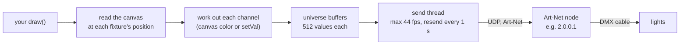
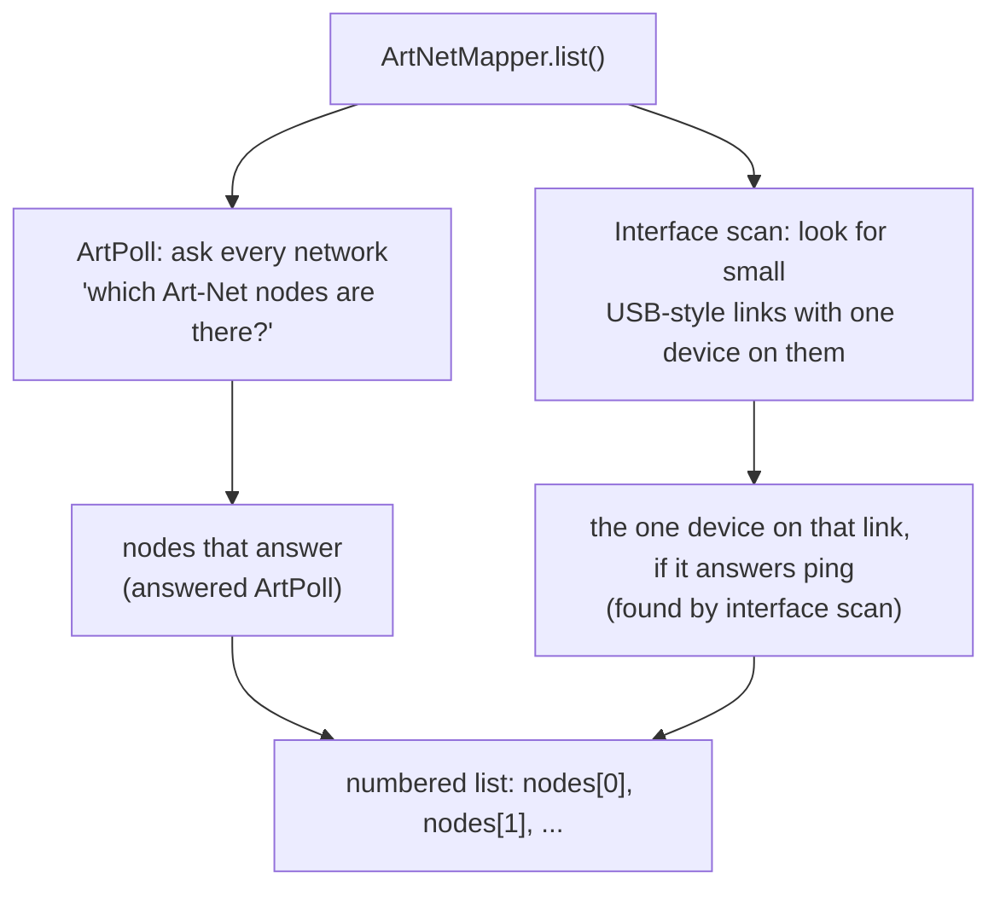
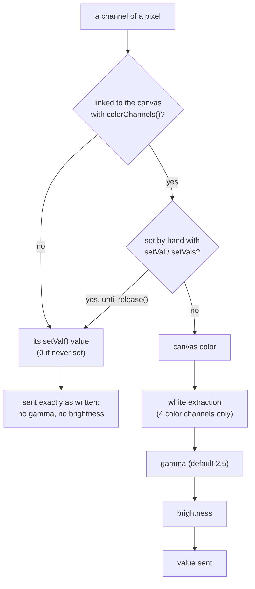
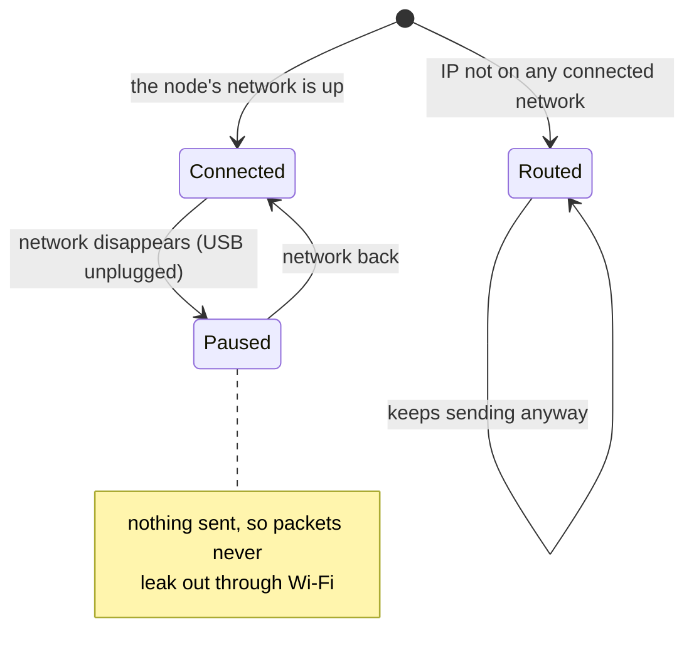

# ArtNetMapper

A [Processing](https://processing.org) library that drives DMX lights from a sketch
over **Art-Net**. You describe your lights in code: how many channels they have,
their DMX address, and where they sit on the canvas. The library reads the colors
under them every frame and sends them to an Art-Net node, which outputs DMX.
The idea is the same as [FadeCandy](https://github.com/PimentNoir/fadecandy)'s
mapping, for DMX fixtures.

```java
import artnetmapper.*;

ArtNetMapper dmx;

void setup() {
  size(600, 300);
  String[] nodes = ArtNetMapper.list();     // prints the Art-Net nodes found
  dmx = new ArtNetMapper(this, nodes[0]);    // no node? use "127.0.0.1"

  Fixture par = dmx.fixture(4, 1);           // a light with 4 channels at DMX address 1
  par.setPos(300, 150);                      // where it sits on the canvas
  par.colorChannels(0, 1, 2, 3);             // its channels 0-3 are red, green, blue, white
}

void draw() {
  background(frameCount % 255, 0, 120);     // the light follows the canvas
}
```

- Works with Processing 4 (tested on 4.5.7, Java 17).
- Any Art-Net-to-DMX node. Tested with an Electroconcept USB Node, which shows up as a
  USB network adapter at `2.0.0.1`.
- No dependencies, no vendor software. MIT license.

---

## Contents

1. [How it works](#how-it-works)
2. [Finding nodes](#finding-nodes-list)
3. [Fixtures: channels and addresses](#fixtures-channels-and-addresses)
4. [Placing fixtures on the canvas](#placing-fixtures-on-the-canvas)
5. [Where each channel's value comes from](#where-each-channels-value-comes-from)
6. [Sending](#sending)
7. [All methods](#all-methods)
8. [Examples](#examples)
9. [Install and build](#install-and-build)

---

## How it works

Every frame, after your `draw()` finishes, the library reads the canvas at each
fixture's position, works out every channel's value, and hands the result to a
background thread. That thread sends it to the node at up to 44 frames per second.



- Markers are drawn on the canvas at each fixture's position (`showLocations`), after
  the colors are read, so they never end up in the light.
- When the sketch stops, the lights get a blackout (`blackoutOnExit`).
- One `ArtNetMapper` sends to one node. Create several for several nodes.

---

## Finding nodes: `list()`

`ArtNetMapper.list()` works like `Serial.list()`: it scans for about 1.5 s, prints
a numbered list, and returns the IPs.

```
ArtNetMapper: found 1 Art-Net node:
  [0] "2.0.0.1"  Electroconcept USB NODE  (answered ArtPoll, en6)
```

It looks for nodes in two ways, because some USB nodes never answer the standard
Art-Net "who's there?" message (ArtPoll):



- Wi-Fi and office networks are never swept, so phones and printers don't show up.
- With no node, the list is empty and `nodes[0]` fails, as with `Serial.list()[0]`.
  To work without hardware, pass an IP yourself: `new ArtNetMapper(this, "127.0.0.1")`.
- If the node's USB link disappears (cable bumped), sending pauses and resumes on
  its own when it's back.

---

## Fixtures: channels and addresses

A **fixture** is a light with a number of DMX channels, starting at a DMX address.
What each channel does comes from the light's manual; you decide in code.

Two different numbers are involved, and they count differently:

| | counts from | where you see it |
|---|---|---|
| **DMX address** | **1** (1-512) | set on the light itself; `fixture(channels, address)` |
| **channel** inside a fixture | **0** | `setVal(ch, v)`, `colorChannels(...)` |

An 8-channel par at DMX address 1, as listed in its manual:

```
DMX address    1        2      3       4      5       6        7      8
               │        │      │       │      │       │        │      │
channel        0        1      2       3      4       5        6      7
             dimmer    red   green   blue   white   strobe    mode   speed
```

```java
Fixture par = dmx.fixture(8, 1);       // 8 channels, starting at DMX address 1
par.colorChannels(1, 2, 3, 4);         // channels 1-4 follow the canvas color
par.setVal(0, 255);                    // dimmer full
par.setVal(5, 0);                      // strobe off
```

The same light in its 4-channel mode (red green blue white) would be
`dmx.fixture(4, 1)` with `colorChannels(0, 1, 2, 3)`.

### Strips and matrices

A **strip** (light bar) or **matrix** (grid) is a fixture made of several **pixels**,
each with the same channels. `strip(channelsPerPixel, address, pixels)`:

```java
Fixture bar = dmx.strip(3, 1, 4);      // 4 pixels x 3 channels (RGB), from DMX address 1
```

```
DMX address    1  2  3 │ 4  5  6 │ 7  8  9 │ 10 11 12
channel        0  1  2 │ 0  1  2 │ 0  1  2 │ 0  1  2
               r  g  b │ r  g  b │ r  g  b │ r  g  b
               pixel 0 │ pixel 1 │ pixel 2 │ pixel 3
```

`bar.setVal(0, 255)` sets channel 0 on every pixel; `bar.pixel(2).setVal(0, 255)`
sets it on pixel 2 only.

### Universes

One universe holds 512 DMX addresses. Every method that creates a fixture has an
optional universe (counted from 0, default 0) before the address:

```java
dmx.fixture(4, 1);           // universe 0, DMX address 1
dmx.fixture(4, 1, 5);        // universe 1, DMX address 5
dmx.strip(3, 2, 1, 170);     // universe 2, DMX address 1, 170 pixels
```

A fixture can't cross from one universe to the next. If it doesn't fit, the sketch
stops in `setup()` with a message that suggests a valid address. Each fixture prints
a line when it's added, so a mistake in argument order is easy to spot:

```
ArtNetMapper: added strip, 4 pixels x 3 channels, universe 0, DMX 1-12
```

---

## Placing fixtures on the canvas

Positions are in sketch pixels. A fixture that only uses `setVal()` doesn't need a
position.

```
 setPos(x, y)               line(x1, y1, x2, y2)             rect(x, y, w, h)
 a par: one point           a strip: pixel 0 at the          a matrix: one pixel in the
                            first point, the last pixel      center of each cell
                            at the second point

      ┌──────────┐            ┌──────────────────────┐         ┌───────────────────┐
      │          │            │                      │         │  (x,y)            │
      │    ●     │            │  0   1   2   3   4   │         │   ┌───┬───┬───┐   │
      │  (x,y)   │            │  ●───●───●───●───●   │         │   │ ● │ ● │ ● │   │
      │          │            │ x1,y1         x2,y2  │         │   ├───┼───┼───┤ h │
      └──────────┘            └──────────────────────┘         │   │ ● │ ● │ ● │   │
                                                               │   └───┴───┴───┘   │
                                                               │         w         │
                                                               └───────────────────┘
```

- `rotate(radians(15))` turns a matrix around the center of its rect.
- `sampleRadius(r)` averages a square of radius `r` around each position, instead
  of reading one pixel.
- Placement can change in `draw()`, e.g. `par.setPos(mouseX, mouseY)`.

### Matrix wiring

Which cell is pixel 0, 1, 2... depends on how the matrix is wired:
`wiring(wiring, corner, order)`.

```
 PROGRESSIVE, TOP_LEFT, ROWS       SERPENTINE, TOP_LEFT, ROWS        SERPENTINE, TOP_LEFT, COLUMNS
 (default)                         every other row runs back         every other column runs back

   0 → 1 → 2 → 3                     0 → 1 → 2 → 3                     0   5 ← 6   11
                                                 ↓                     ↓   ↑   ↓   ↑
   4 → 5 → 6 → 7                     7 ← 6 ← 5 ← 4                     1   4   7   10
                                     ↓                                 ↓   ↑   ↓   ↑
   8 → 9 → 10 → 11                   8 → 9 → 10 → 11                   2 → 3   8 → 9
```

Corners: `TOP_LEFT`, `TOP_RIGHT`, `BOTTOM_LEFT`, `BOTTOM_RIGHT` (where pixel 0 is).

---

## Where each channel's value comes from

Every channel of every pixel is worked out like this, once per frame:



- **colorChannels(r, g, b)** or **(r, g, b, w)** says which channels follow the
  canvas color. Give 3 numbers for RGB, or 4 for RGBW.
- **White extraction** (on by default with 4 color channels): white = the smallest
  of red, green and blue, which is then taken away from all three, so pure white
  on the canvas lights only the white LED. `whiteMode(false)` turns it off.
- **gamma** makes dark colors look right on LEDs. 2.5 matches Resolume Arena; 1.0
  turns it off. Set it for all fixtures with `dmx.gamma()`, or per fixture.
- **setVal / setVals** values win over the canvas until `release()`. That's how a
  color is hard-coded: `par.setVals(255, 0, 0, 0)`. They're never changed by gamma
  or brightness, so a mode or strobe value reaches the light exactly.

```java
void mousePressed()  { par.setVals(255, 0, 0, 0); }   // hard-coded red
void mouseReleased() { par.release(); }                 // back to the canvas
```

---

## Sending



- Frames are sent when a channel changes, at most `maxRate` times per second
  (default 44, the most DMX can show). An unchanged frame is resent once a second,
  because many nodes switch off when data stops.
- `dmx.blackout(true)` keeps every light at 0 until `blackout(false)`. Fixture values
  keep updating meanwhile.
- `dmx.autoSend(false)` + `dmx.send()` sends only when you say so.
- Sending uses a random free UDP port, so it runs fine next to Resolume or other
  Art-Net software. An idle sketch costs about 0.3% of one CPU core.

---

## All methods

Grouped by what they do. The same list is at the end of every example. You can also
print it in the console with `ArtNetMapper.printPublicMethodsFor(Fixture.class)`.
`reference/index.html` in the library folder has the details of each method.

| Group | ArtNetMapper (`dmx`) | Fixture (`par`, `strip`, ...) |
|---|---|---|
| **Create and connect** | `ArtNetMapper.list()`, `new ArtNetMapper(this, ip)`, `fixture(channels, [universe,] address)`, `strip(channelsPerPixel, [universe,] address, pixels)`, `matrix(channelsPerPixel, [universe,] address, cols, rows)` | |
| **Place** | | `setPos(x, y)`, `line(x1, y1, x2, y2)`, `rect(x, y, w, h)`, `rotate(angle)`, `wiring(wiring, corner, order)` |
| **Follow the canvas** | `source(pg)`, `gamma(g)`, `brightness(level)`, `showLocations(on)` | `colorChannels(r, g, b[, w])`, `sampleRadius(r)`, `whiteMode(on)`, `gamma(g)` |
| **Set values by hand** | | `setVal(ch, v)`, `setVals(v0, v1, ...)`, `release()`, `release(ch)`, `getVal(ch)`, `pixel(i)` |
| **Sending** | `autoSend(on)`, `send()`, `maxRate(fps)`, `blackout(on)`, `isBlackout()`, `blackoutOnExit(on)` | |
| **Info** | `isConnected()`, `ip()`, `fixtures()`, `getUniverse(u)`, `getGamma()`, `getBrightness()`, `getMaxRate()` | `channels()`, `pixels()`, `totalChannels()`, `address()`, `lastAddress()`, `universe()`, `x()`, `y()`, `getGamma()`, `getSampleRadius()`, `getWhiteMode()` |

`pixel(i)` gives one pixel of a strip or matrix, with `setVal`, `setVals`, `release`,
`getVal`, `x()` and `y()`.

---

## Examples

Open them in Processing under *File → Examples → Contributed Libraries → ArtNetMapper*.

| Example | Shows |
|---|---|
| `Discover` | listing the nodes connected to this computer |
| `TwoPars` | two RGBW pars following a gradient; hard-coding a color with the mouse |
| `ParModes` | an 8-channel par: colors from the canvas, dimmer and strobe by hand |
| `MouseDimmer` | a fully manual light, no canvas: channels set with `setVal()` |
| `Strip` | a 30-pixel strip along a line you can drag |
| `Matrix` | an 8x8 serpentine matrix, rotated, over a plasma |
| `OffscreenSource` | reading the colors from a `PGraphics` instead of the window |

---

## Install and build

**Build from source** (needs a JDK 17+ and Gradle, e.g. `brew install openjdk@17 gradle`):

```
gradle installLibrary
```

This builds the library, runs the tests and copies it to
`~/Documents/Processing/libraries/ArtNetMapper`. Restart Processing afterwards.
Paths can be changed with `-PprocessingCore=...` and `-PsketchbookLibraries=...`, or
in `~/.gradle/gradle.properties`.

**Tests**

| Command | Checks |
|---|---|
| `gradle test` | packets, color pipeline, wiring, address checks, sender timing, discovery parsing |
| `java tests/loopback/LoopbackCheck.java` | runs a real sketch and checks the packets it sends to a fake node on this computer |

**Project layout**

```
src/main/java/artnetmapper/
  ArtNetMapper.java   public entry point: fixtures, per-frame sampling
  Fixture.java        channels, placement, canvas link, hand-set values
  Sender.java         universes, UDP socket, send thread, connection check, blackout
  Discovery.java      list(): ArtPoll and interface scan
  Overlay.java        location markers
  ArtNetPackets.java  ArtDmx / ArtPoll packets
  ColorMath.java      white extraction, gamma, brightness
examples/             example sketches
tests/                loopback test and QC sketches
DESIGN.md             the agreed design and its decisions
EVALUATION.md         what each version taught us
```

## License

MIT. See [LICENSE](LICENSE).
